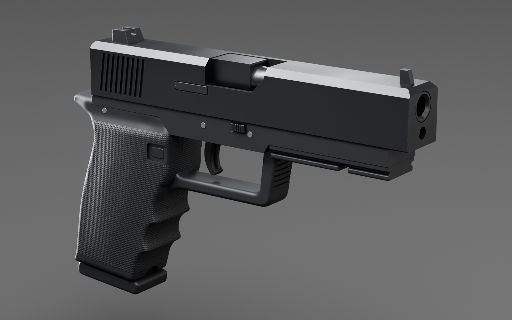

# Glock 17 – 3D-Modell

Interaktives 3D-Anschauungsmodell einer Glock 17 (Gen 4) in Originalmaßen, aufgebaut mit [three.js](https://threejs.org).
Modelliert ist nur die Außenform, ohne Innenmechanik.

## Dateien

| Datei | Inhalt |
| --- | --- |
| `index.html` | 3D-Viewer: drehen, zoomen, Ansichten (3/4, links, rechts, oben), Rahmenfarbe (Schwarz, Coyote, Oliv, Grau), Bemaßung ein/aus, Teilenamen per Hover/Antippen |
| `blender/glock17.blend` | Detailliertes Blender-Modell mit Studio, Kameras und Renderings (siehe unten) |
| `glock17.glb` | Das gleiche Modell als glTF-Binärdatei (in Metern, 18 benannte Teile, ca. 19 000 Dreiecke, mit Griffstruktur als Normal-Map) |

## Blender-Datei

`blender/glock17.blend` ist eine detailliertere Fassung für Blender 5.2 (ältere 4.x-Versionen sollten sie meist auch öffnen):
Studio-Szene mit Hohlkehle, Lichtsetup für die schwarze Waffe und 8 Kameras (`Cam_Hero`, `Cam_Right`,
`Cam_Left`, `Cam_Top`, `Cam_Detail_Rear`, `Cam_Detail_Port`, `Cam_Detail_Grip`, `Cam_Muzzle`). Jede Kamera hat
ein eigenes Bild in der Zeitleiste (Bild 4 = Hero), damit Kamera und Licht gemeinsam umschalten.
Gerendert wird mit Cycles (AgX), fertige Bilder liegen in `blender/renders/`.

- **Modell:** 20 Teile in der Sammlung „Glock17 Parts“, Maße in mm unter dem Root-Empty `Glock17`.
  Bohrungen, Rillen, Auswurffenster und Gravur sind *live* Boolean-Modifier; die Schneidkörper liegen
  ausgeblendet in „Cutters“. Fasen, Glättung und Weighted Normals stecken ebenfalls im Modifier-Stack.
- **Materialien:** Nitrierter Stahl mit Rauheitsvariation, Polymer, die Gen-4-Griffstruktur als prozedurale
  Bump-Map. Die Rahmenfarbe ändert sich über den Node „Rahmenfarbe“ in den Materialien `Frame` und `Grip`.
- **Hinweise in der Datei:** Der Text-Block „LIESMICH“ im Scripting-Workspace.
- **Neu erzeugen:** `python blender/build_glock.py --render all` (mit `pip install bpy==5.2.2`, Python 3.13)
  oder `blender --background --python blender/build_glock.py -- --render all`. Optionen stehen im Kopf des Skripts.
  Ein Bild in 1600×1000 mit 128 Samples braucht auf 4 CPU-Kernen etwa 5–6 Minuten.

Gemessen am Blender-Modell: 202 × 138 × 31,5 mm, Lauf 114 mm, Visierlinie 165 mm, Abzugsabstand 72 mm.



## Ansehen

- **Viewer:** `index.html` im Browser öffnen (braucht Internet für three.js vom CDN).
  Falls der Browser lokale Dateien blockiert: `npx serve .` und dann `http://localhost:3000` öffnen.
- **GLB-Datei:** lässt sich direkt in Blender (*Datei → Import → glTF 2.0*), im Windows-3D-Viewer
  oder auf <https://gltf-viewer.donmccurdy.com> öffnen.

## Maße

Der Schalter „Maße“ blendet Maßlinien ein. Die Werte werden beim Laden direkt am Modell gemessen
(Bounding-Box bzw. Strahl-Treffer), nicht fest eingetragen.

| Maß | Vorbild (ca.) | Modell |
| --- | --- | --- |
| Gesamtlänge | 202 mm | 202 mm |
| Höhe mit Magazin | 138 mm | 138 mm |
| Breite | 32 mm | 32 mm |
| Schlitten | 186 × 25,5 mm | 186 × 25,5 mm |
| Lauflänge | 114 mm | 114 mm |
| Visierlinie | 165 mm | 165 mm |
| Abzugsabstand | 72 mm | 72 mm |

## Details

- **Schlitten:** 45°-Fasen oben, gefaste Front und Rückseite, 9 Griffrillen je Seite, Auswurffenster
  mit schräger Vorderkante, Auszieher in eigener Vertiefung, Kerbe für den Schlittenfanghebel,
  Gravur „17 Gen4 / AUSTRIA 9x19“ links.
- **Lauf:** Laufhaube und Patronenlager im Auswurffenster, sechseckiges Polygonprofil, Mündungskrone.
- **Visierung:** Kimme mit weißer U-Markierung, Korn mit weißem Punkt (6,1 mm hoch).
- **Rahmen:** Zubehörschiene mit Querschlitz, Rahmenplatte, geriffelte Front am Abzugsbügel,
  Gen-4-Griffstruktur (1-mm-Pyramiden), Fingermulden, Beavertail, Griffmulde am Magazinschacht,
  vergrößerter Magazinhalter, Zerlegehebel mit Riffelung, drei Haltestifte.
- **Abzug:** Safe-Action-Abzug mit Sicherungszunge.

## Aufbau

Alle Maße im Code sind Millimeter. Die Teile entstehen aus extrudierten Profilen
(`THREE.ExtrudeGeometry` mit Fasen); Auswurffenster, Rillen, Bohrungen und Kerben werden per CSG
([three-bvh-csg](https://github.com/gkjohnson/three-bvh-csg)) herausgeschnitten. Die Griffstruktur
ist eine prozedural erzeugte Normal-Map. Auf Geräten mit Maus rendert der Viewer zusätzlich
Ambient Occlusion (GTAO) für Schatten in Vertiefungen.

## GLB neu exportieren

Nach Änderungen am Modell im geöffneten Viewer in der Browser-Konsole ausführen:

```js
await pistolModel.downloadGLB()
```
